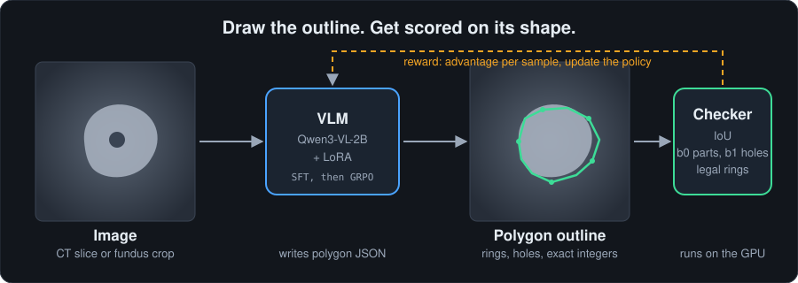
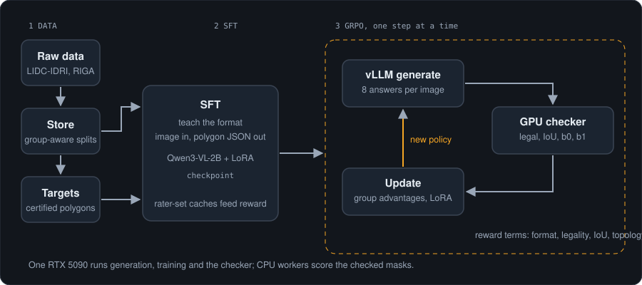
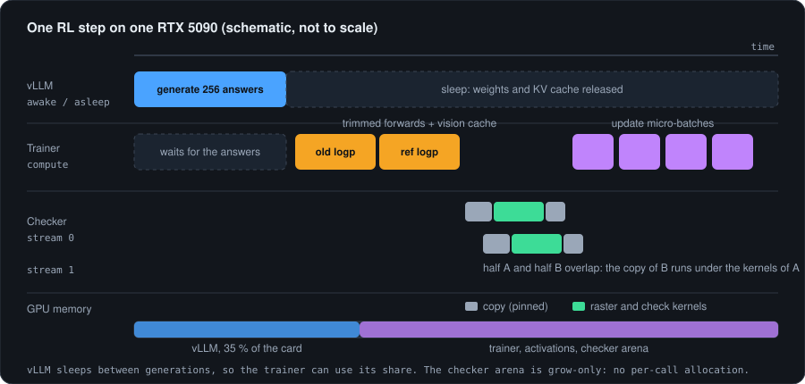
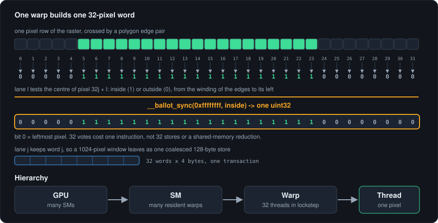
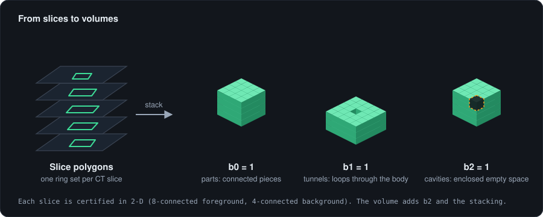
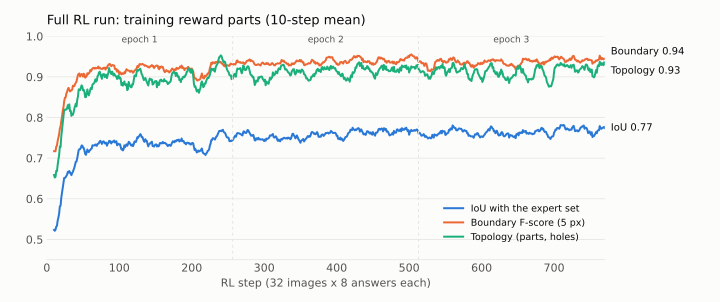
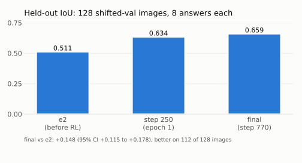
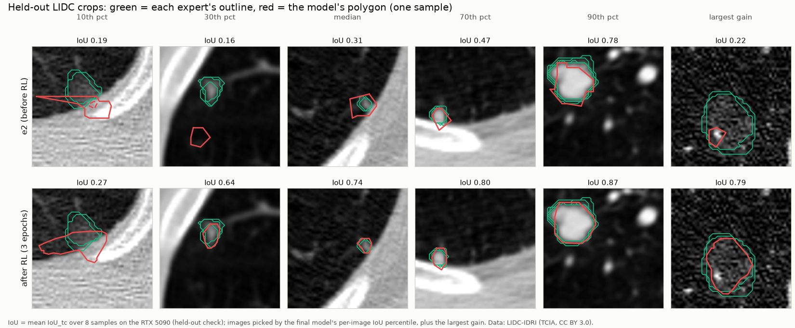

<div align="center">

# ObjectDelineation

**A small vision-language model learns to outline objects as polygons. A GPU checker proves the outlines are right.**




</div>

A model that draws a lung nodule must get more than the overlap right. It must get the shape right: one part or
two, with a hole or without. This project trains Qwen3-VL-2B (LoRA) to write polygon JSON, and rewards it with an
exact geometry checker. The checker counts parts and holes (Betti numbers b0 and b1), validates every ring with
integer arithmetic, and scores against the set of answers that expert annotators gave. Training is SFT, then GRPO
reinforcement learning with TRL and vLLM on one GPU. The checker itself is a custom CUDA engine.

## 🎯 What it does

- **Input:** a CT slice (lung nodules, LIDC-IDRI) or a fundus crop (optic disc and cup, RIGA).
- **Output:** polygon JSON on a 0-1000 grid: rings, holes, nothing else.
- **Reward:** format gate, ring legality, IoU against the expert set, and topology (b0 parts, b1 holes).
- **Why sets, not one mask:** LIDC readers disagree on topology for 6.1 % of nodules, and every nodule with a hole
  is one they disagree on (`docs/research/records/phase0/RESULTS.md`). A shape that any expert drew counts as correct.
  Pixels where experts disagree count as neither right nor wrong.

## ⚙️ How it works



1. **Data.** LIDC-IDRI and RIGA are parsed into a Parquet store with group-aware splits (`src/objdel/data`).
2. **Polygon targets.** Each expert mask becomes a certified, canonical polygon (`src/objdel/targets`).
3. **SFT.** The model learns the output format and a first guess at the shapes.
4. **GRPO.** vLLM writes 8 answers per image. The checker scores each one. Group advantages update the LoRA.
5. **Reward.** Exact, per-sample, and the same code path in tests, on the CPU and on the GPU.

## 🚀 The GPU story

One RTX 5090 runs three jobs: vLLM generation, the trainer, and the checker. They share the card in turns.



**Trainer (`src/objdel/train/fast.py`).**
- Per-chunk trimmed forwards. TRL pads all 256 answers of a step to the longest one. Each chunk is cut to its own
  width, rounded up to one of 8 bucket sizes so compiled code sees few shapes.
- A per-step vision-feature cache. The 8 answers of a prompt share one image, so the frozen vision tower runs once
  per distinct image per step, not once per answer per pass.
- One image pad per image to vLLM, checked against the trainer's ids on every call: vLLM samples from exactly the
  image features the trainer scores (TRL as shipped does not, for Qwen3-VL).
- Rope positions computed once per prompt row per step (`RopeCache`) and sliced per chunk: Qwen3-VL's 3-D
  positions walk every token on the CPU, and TRL recomputes them in every forward.
- No redundant old-logprob pass. With one generation per optimizer step the weights do not move before the update,
  so the update's own (detached) log-probabilities are the old ones, and its forward sets vLLM's importance ratio.
- Update micro-batches cut from the length-sorted batch. With dr_grpo's constant normaliser the split leaves the
  update unchanged, and rows of like length share a chunk, so each chunk is trimmed to its own width.
- No fp32 copy of each LoRA input under bf16 autocast: the matmul casts it back anyway (bit-identical).
- Rewards scored on a background thread while the GPU computes the reference log-probabilities.
- Every setting is measured on the card first (`experiments/phase2/profile.py`): micro-batch, checkpointing, regional
  `torch.compile`, CUDA Graphs. The profiler trace (GPU busy 70 %, 7,233 `.item()` reads per step) drives the next
  step.
- vLLM sleep mode frees its share of the card between generations.

**Checker and scorer (`cuda/gpucheck.cpp`).** One source file builds for the CPU and for nvcc. Every algorithm is a
`__host__ __device__` functor. All checking and scoring runs here: polygon, mask, defects, IoU_tc, F5, g_area and the
size-filtered topology signature. The experts' tables stay resident on the device, and only per-object numbers come
back. No mask is copied to the host for scoring (`docs/research/notes/gpu_scoring.md`).
- A grow-only device arena and two pinned staging buffers per stream lane. Nothing is allocated per call.
- Two CUDA streams. A large batch splits in two halves, so the copy of one half overlaps the kernels of the other.
- The raster runs one warp per pixel row, and builds each 32-pixel word with `__ballot_sync`.
- Bit-exact against the CPU checker it replaced, polycore, on two architectures (sm_120 and sm_86: 0 mismatches).
  polycore is now archived (`archive/cpu_checker`), and its results are recorded per case in
  `tests/goldens/polycore.npz`. The checker is also clean under `compute-sanitizer` memcheck and initcheck (0 errors
  on 40 GPU tests, `experiments/phase2/perf/k1_results.md`).
- The device scorer is bit-identical to the numpy scorer it replaced (`tests/oracles/score_numpy.py`). Counts are
  integers, distance sums are exact multiples of 2^-23, and nothing is contracted into FMA.
- Union-find connected components run on each object's bounding box (Playne and Hawick 2018) and give the signature.



Each thread tests one pixel and votes. One instruction packs 32 votes into a `uint32`. Lane `j` keeps word `j`, so a
1024-column window leaves in one coalesced store. Masks are bit-packed end to end.

## 🧊 3D volumes

LIDC-IDRI is a 3-D CT collection, and a nodule is a stack of slices. The system treats it that way.



- **Slice to volume.** The model outlines one slice at a time. The polygons of consecutive slices are rasterized
  and stacked into one voxel mask (`objdel.checker.volume.stack`).
- **Voxel clusters.** Annotations from different readers are grouped into nodules by shared voxels
  (`archive/phase0/lidc_census.py`; the `b0_3d_*` and `cavity_any_*` columns in
  `docs/research/records/phase0/results/lidc/clusters.csv`).
- **Three Betti numbers.** Each voxel is a closed unit cube, so parts are 26-connected and the background is
  6-connected. `betti3d` counts b0 (parts) and b2 (cavities) by labeling, and b1 (tunnels) from the Euler
  characteristic of the cube complex (χ = b0 − b1 + b2). Slice-level b0 and b1 are the 2-D shadows of the same idea.
- **Set-valued scoring.** `topology_any` scores a predicted volume against the set of reader volumes, exactly as
  the slice-level topology terms do: a match with any reader counts.

`tests/test_volume.py` checks the counts on worked shapes (a hollow cube has one cavity, a ring one tunnel, a corner
contact joins two parts) and on stacked slices of a hollow nodule.

## 📊 Results

| What | Result | Source |
|---|---|---|
| Checker certificates, real masks | 0 failures on 26,820 RIGA masks and 40,189 LIDC slices | `docs/research/records/phase0/RESULTS.md` |
| Raster and legality vs oracle | 0 of 849,802,293 pixels differ on 10,000 shapes; 0 of 10,000 rings | `experiments/phase1/RESULTS.md` (K1, K2) |
| CUDA checker vs CPU checker | 195,809 of 195,809 cases bit-identical (RTX 4090) | `experiments/cuda_checker/RESULTS.md` |
| LIDC topology disagreement | 114 of 1,877 nodules (6.1 %) after filtering | `docs/research/records/phase0/RESULTS.md` |
| Rung 1 SFT (LFM2.5-VL-450M) | Failed the entry gates: median IoU 0.495 shifted, 0.092 rescaled; hole recall 0.5 % | `experiments/phase2/RESULTS.md` |
| CUDA checker on an RTX 5090 | 0 mismatches on 8,559 fuzz polygons and all 13 defect classes | `experiments/phase2/perf/p1_results.md` |
| G-probe, Qwen3-VL-2B SFT (e2), 20 RL steps | PASS: held-out reward 0.694 / 0.679 → 0.769, legal 94.5 % → 98.2 % | `docs/research/notes/issues_solved_2026-11-07.md` |
| **Full RL, 3 epochs (770 steps) on e2** | **Held-out IoU 0.511 → 0.659** (+0.148, 95 % CI +0.115 to +0.178; better on 112 of 128 images); legal 94.5 % → 98.8 % | `docs/research/notes/full_rl_2026-11-08.md` |
| **Final model on the whole splits** (shifted crops, 8 samples each) | **Test (2,200): IoU 0.645, boundary F 0.816, precision 0.695, recall 0.748, Dice 0.701, legal 99.4 %**; validation (1,084): IoU 0.618, F 0.806, precision 0.689, recall 0.716 | `docs/research/notes/final_eval_2026-11-08.md` |

### 🧠 The full RL run

One RTX 5090, 5 h 52 min, about $4.56. vLLM wrote 197,120 answers (770 steps x 32 images x 8), and the CUDA checker
scored every one of them on the device.



Most of the gain comes in the first 50 steps; IoU then keeps rising slowly through epochs 2 and 3. The test that
counts is on images the model never trained on: 128 shifted-validation images, 8 answers each.



What the model draws, before and after RL, on held-out crops picked by percentile (not the best ones): green is each
expert's outline, red is the model's polygon. RL taught it to trace the nodule instead of boxing it or outlining only
its bright core; the 10th-percentile crop shows the failures that remain (an outline that spills into the chest wall).



The first CUDA build (R0 v3) was exact but slower than the CPU checker: 54,710 polygons/s at 16 vertices and batch
1,024, held back by per-call allocation and managed memory. With the arena, pinned staging and two streams, the same
shapes run at **7.74 M polygons/s on an RTX 5090 (141x)**, 87x the polycore loop on the box's CPU.

**RL speed on the RTX 5090** (Qwen3-VL-2B + LoRA, 32 prompts x 8 answers per step; `experiments/phase2/perf/p1_results.md`)

| Setting | s / step | Notes |
|---|---|---|
| TRL 1.17 GRPO as shipped | 80.3 | vLLM samples off-policy: token logprob gap up to 25 nats, IS ratio mean 0.65-0.81 |
| **FastGRPO** (micro-batch 16 x 16) | **44.3** | **1.81x**; on-policy (gap mean 0.009 nats); rewards wait 3 ms |
| FastGRPO, micro-batch 32 x 8 | 59.1 | wider padded windows |
| FastGRPO + regional `torch.compile` | 47.9 | recompiles across widths and grad modes; off |
| FastGRPO + CUDA Graphs (`reduce-overhead`) | crash | per-layer graph replay overwrites outputs; conflicts with vLLM's sleep allocator |
| FastGRPO, no gradient checkpointing | OOM | over 31.45 GiB beside vLLM |
| FastGRPO + on-device scoring + image memo (R3) | 36.3 | `docs/research/notes/issues_solved_2026-11-07.md` (R2 on the same settings: 56.6) |
| **Full RL run** (770 steps, same settings) | **27.5** | mean over the run; answers shortened from 128 to ~100 tokens |
| + 64-wide chunks and the no-merge vLLM sync (R4) | 29.9 vs 32.7 | steps 3-15 at ~130-token answers: **8 % faster**, identical rewards; keeping vLLM awake gains nothing (handovers 1.6 s) |
| + **shared-prefix forward**, `--shared-prefix` (R5) | **23.6 vs 31.0** | each prompt runs once per group of 8 answers, not 8 times (0.36 of the tokens): **24 % faster**; step 1 identical (same answers, same gradient norm); `docs/research/notes/shared_prefix_2026-11-08.md` |

One step splits into 7.6 s vLLM generation, 12.3 s old and reference log-probabilities, and 24.4 s update; the reward
(at the time: one checker call for all 256 answers plus scoring on a CPU pool) runs in the background during the
log-probability passes. Scoring now also runs in that one checker call, on the device.

## 🗂️ Repository layout

```
cuda/              the CUDA checker and scorer (gpucheck.cpp: one source for the CPU and the nvcc build)
src/objdel/
  checker/         rings (polygonizer seam), Betti topology, certificates, 3D volume checks
  geometry/        output spec: strict parser, serializer, canonical rings, boxes
  targets/         model frame (crop, shift, rescale, edge views) and certified polygon targets
  reward/          cache spec and expert caches (resident on the device), per-rollout scores, group advantages
  data/            RIGA and LIDC readers, group-aware splits, Parquet store, training windows and schedule,
                   coverage, data-quality gates
  train/           TRL integration (FastGRPO, TRL contract check), rewards, callbacks, configs, NVTX ranges
  eval/            metrics, cluster bootstrap signal, fair ceiling, answer selection, audit and gates
tests/             pytest suite (runs on all cores), with oracles in tests/oracles/ and goldens in tests/goldens/
experiments/       scripts per phase, run as modules: phase1 data builders, phase2 training, evaluation, Vast tools
docs/              documentation site, architecture decisions, reference, runbooks, research, the 2.0 plan
archive/           retired code and lab evidence, never imported or built (see archive/README.md)
data/  runs/       downloaded data and run outputs (git-ignored, never committed)
```

Plan: [ROADMAP.md](ROADMAP.md); the current build follows
[implementation 2.0](docs/implementation2.0/Implementation.md). Phase results:
[Phase 0](docs/research/records/phase0/RESULTS.md), [Phase 1](experiments/phase1/RESULTS.md),
[Phase 2](experiments/phase2/RESULTS.md), [CUDA checker](experiments/cuda_checker/RESULTS.md).
Speed work: [issues](experiments/phase2/perf/issues.md), [implementation](experiments/phase2/perf/implementation.md).

## ⚡ Quick start

```bash
make setup        # .venv with Python 3.12 (uv), editable install, builds the checker (its CPU build)
make test         # fast test suite on all cores (pytest-xdist); make test-all adds the slow gates
make lint
make dead         # unused-code check (vulture)
make cuda         # build the CUDA checker (needs nvcc)
make preflight    # prove data, checker and code before any GPU is rented
```

Experiment scripts run as modules, in an isolated interpreter, because downloaded data is untrusted:

```bash
.venv/bin/python -I -m experiments.phase1.reward_gates --help
.venv/bin/python -I -m experiments.phase2.profile --help
```

```python
import numpy as np
from objdel.checker import certify
from objdel.reward import ExpertCache, score_completion
from objdel.targets import build_target, min_areas

y, x = np.ogrid[:100, :100]
raters = np.stack([(y - 50) ** 2 + (x - 50) ** 2 <= r * r for r in (20, 22, 24)])  # 3 raters, one nodule

report = certify(raters[0])                                    # b0, b1, area, perimeter, certificate
text = build_target({"nodule": raters[1]}, ("nodule",), None, min_areas({"nodule": raters})).text  # grid 0-1000
caches = {"nodule": ExpertCache.build(raters)}                 # built once per item, offline
score = score_completion(text, False, ("nodule",), caches, 100, 100)
print(score["format_ok"], score["legal"], score["iou_tc"], score["topo_any"])   # 1.0 1.0 1.0 1.0
```

Rebuilding `data/` from the raw downloads uses the Phase 1 scripts in order (`fetch_lidc_pixels`, `build_data`,
`prepare_rl`, `build_targets`). Commands and hashes are in
[Phase 1 RESULTS, section 8](experiments/phase1/RESULTS.md#8-phase-2-handoff).

## 📚 Research reports

All in `docs/research/reports/`:
- [GPU delineation use case map](docs/research/reports/GPU%20delineation%20use%20case%20map.md): certified geometry for AI, and why the pitch is correctness and topology.
- [GPU delineation RL mix and match](docs/research/reports/GPU%20delineation%20RL%20mix%20and%20match.md): the reward design, prior art and safe claims.
- [NVIDIA CUDA performance for VLM training](docs/research/reports/NVIDIA%20CUDA%20performance%20for%20VLM%20training.md): why the GPU waits on the CPU.
- [RL speed stack on RTX 5090](docs/research/reports/RL%20speed%20stack%20on%20RTX%205090.md): fixing the GRPO stack before renting.
- [Code performance audit 2026-11-06](docs/research/reports/Code%20performance%20audit%202026-11-06.md): training, evaluation and checker paths.

## Documentation

Engineering documentation is in [docs/README.md](docs/README.md): getting started, architecture and decision records,
reference pages (package, CUDA engine, reward, output format, data, configs), guides, runbooks, testing, glossary and changelog.
Repository rules (tests, lint, data handling, commits) are in [docs/contributing.md](docs/contributing.md).

## 📄 Licence and data

The code is under the [MIT licence](LICENSE). The licence covers the code only, not the datasets.
- Datasets are not included. LIDC-IDRI (TCIA) and RIGA are downloaded separately, each under its own licence.
- No images or annotations from either dataset are in this repository.
- Some result tables hold per-series statistics computed from LIDC-IDRI (TCIA, CC BY 3.0).
- RIGA-derived tables are not shared. They stay on the owner's machine.
