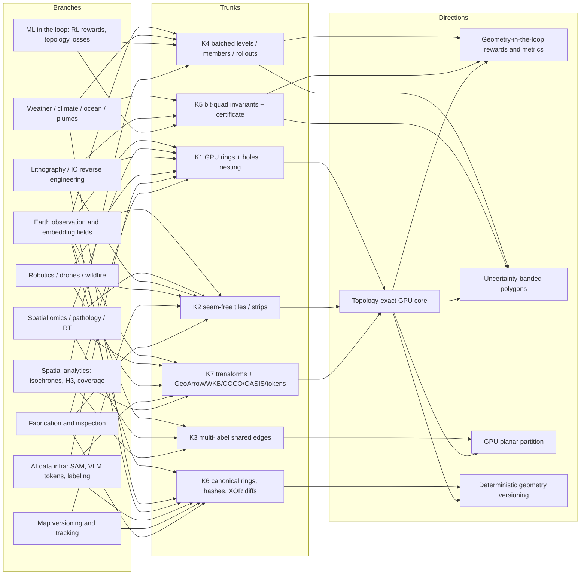

# Rebuild ObjectDelineation as certified geometry for AI

**Recommendation:** turn ObjectDelineation into a **certified, batched geometry runtime**. Masks, label maps and probability fields go in as GPU tensors. Closed rings come out, with holes, parent links and canonical start points. Each output carries a free topology certificate from the bit-quad pass. One launch can process many thresholds, ensemble members or RL rollouts. The research tree covered twelve domain branches and about 45 sub-use-cases. Almost all of them run through the same few trunks: GPU-resident ring linking with nesting, seam-free tiling, multi-label shared edges, batched multi-level extraction, bit-quad invariants, and canonical encoding. Three holes stand out because nobody fills them.

1. **No GPU library emits rings with holes and nesting.** NVIDIA NPP comes closest. It emits per-label boundary-pixel chains, needs host buffers, and skips contours over 256K pixels by default.
2. **Uncertainty products stop at rasters.** Contour boxplots, conformal masks, Carbon Mapper's 72-mask plumes and Copernicus GFM likelihood all ship as rasters, never as polygons.
3. **ML training loops have no geometry or topology signals.** No published VLM-segmentation RL reward uses validity, holes or Betti numbers. LithoGRPO needed a 134–491× speedup just to fit shot count into GRPO.

The strongest creative direction combines two differentiators on one shared kernel:

- **Geometry-in-the-loop:** GPU rewards, metrics and topology gates for RL and training.
- **Uncertainty-banded polygons:** nested, conformal or exceedance rings from ensembles.

Both rest on a fully device-resident core. That core's sort → pair → pointer-jump → CCL-parent design was checked in a CPU prototype and is topologically exact on 3,000 random images. The counter-evidence matters. Raw speed is often *not* the bottleneck:

- Radiotherapy, leather nesting, VLM RL and ERA5-sized ensembles all run acceptably on CPU.
- Learned vector heads (MapTR, Pix2Poly, DiffPlanner) bypass rasterization entirely.
- Much of the demand is inferred from what products ship, not stated by buyers.

So the pitch has to be **correctness, topology, canonicality and in-GPU fusion at batch scale**, not "faster findContours."

## Every branch of the tree funnels through the same few trunks

The search started from the engine's contract: a binary occupancy bitmap with halo, 2×2 classification, closed rectilinear rings, and a pluggable transform. It then expanded outward. Each node is a place where a gridded thing (a mask, label map, probability field, occupancy grid, density or embedding similarity) has to become explicit geometry. Each leaf records which capabilities it needs and what evidence of pain exists.

Eleven capabilities recur. They are the columns of the matrix in the next section:

| Code | Capability |
|---|---|
| **K1** | GPU-resident ring linking with holes and nesting |
| **K2** | Seam-free tiling and streaming strips |
| **K3** | Multi-label planar partitions with shared edges |
| **K4** | Batched multi-threshold / multi-member extraction with nested levels |
| **K5** | Bit-quad invariants and topology certificates |
| **K6** | Canonical rings, content hashes and exact diffs |
| **K7** | Float transforms and zero-copy output formats (GeoArrow, WKB, COCO, RTSTRUCT, OASIS, tokens) |
| **K8** | Topology-preserving simplification and regularization |
| **K9** | Sub-pixel or differentiable contouring |
| **K10** | ML-loop hooks (DLPack batches, rewards, straight-through gradients) |
| **K11** | Edge/embedded footprint and compact codecs |

### The use-case tree

| Branch | Sub-use-case | Needs | Evidence of pain or gap | Is speed the bottleneck? |
|---|---|---|---|---|
| **Earth observation** | Field boundaries at planet scale | K1 K2 K3 K7 K8 | FTW has **3.17B field polygons**, made by thresholding softmax at 0.5 and polygonizing ([Source Cooperative](https://source.coop/ftw/global-data/llms.txt)). No polygonization runtime is published ([arXiv 2602.08131](https://arxiv.org/html/2602.08131v1)). | Yes, at annual-refresh volume |
| | Building footprints and temporal stacks | K1 K2 K6 K7 K8 | Google 2.5D Temporal ships **rasters only** for 2016–2023 ([EE catalog](https://developers.google.com/earth-engine/datasets/catalog/GOOGLE_Research_open-buildings-temporal_v1?hl=en)). | Partly; quality matters more |
| | Embedding-similarity object search | K1 K2 K4 K7 K10 | Earth Engine: "**Vectorization is a memory and compute-intensive operation**", causing timeouts ([EE tutorial](https://developers.google.com/earth-engine/tutorials/community/satellite-embedding-05-similarity-search)) | Yes, interactive |
| | Flood/hazard extents with likelihood | K4 K7 | GFM likelihood is **COG only**; extent is GeoJSON ([GFM PUM](https://extwiki.eodc.eu/en/GFM/PUM/Products)) | No; it is a representation gap |
| | On-orbit vectors instead of pixels | K1 K11 | Pelican-4 Jetson Orin emits detections as GeoJSON, not delineations ([Via Satellite](https://www.satellitetoday.com/imagery-and-sensing/2026/04/07/planet-details-ai-driven-object-detection-onboard-pelican-4-satellite)) | Bandwidth and latency |
| | EUDR plot verification | K3 K7 | Polygons are required above 4 ha; no confidence requirement ([EUR-Lex](https://eur-lex.europa.eu/legal-content/EN/TXT/HTML/?uri=CELEX:32023R1115)) | Weak |
| **Weather, climate, ocean, science** | ML-ensemble extreme-event objects | K4 K5 K6 K10 | HENS runs **7,424 members/day** ([arXiv 2408.01581](https://arxiv.org/abs/2408.01581)). TempestExtremes spends **66% of time on file input** and has no GPU path ([GMD](https://gmd.copernicus.org/preprints/gmd-2020-303/gmd-2020-303-manuscript-version4.pdf)). | Only at HENS-class multiplicity |
| | Minute-cadence warning polygons (PHI/TIM, ProbSevere) | K4 K7 K8 | TIM polygons are meant to update every minute ([NOAA GSL](https://gsl.noaa.gov/tim/)). ProbSevere latency is 2–5 min ([NSSL EWP](https://inside.nssl.noaa.gov/ewp/tag/glm/page/4)). | Pipeline latency, not tracing |
| | Ocean eddies via nested SSH contours | K4 K5 | Python PET scans 2 mm levels and finds ~5,936 eddies/day ([ESSD](https://essd.copernicus.org/articles/14/1087/2022/essd-14-1087-2022.html)) | Moderate |
| | Methane plumes from 72 candidate masks | K4 K5 K7 | The output is a **GeoTIFF**, not a polygon ([Carbon Mapper ATBD](https://assets.carbonmapper.org/documents/L3_L4%20Algorithm%20Theoretical%20Basis%20Document_021726.pdf)) | No; representation gap |
| | Minkowski functionals / ECC in cosmology | K4 K5 | GPU ECC already reaches 5–10 Gvox/s; disk is 75–99.7% of runtime ([arXiv 2203.09087](https://ar5iv.labs.arxiv.org/html/2203.09087)) | Counts matter, polygons don't |
| | Grain-boundary networks | K3 K8 | Topology of the boundary network is the stated issue ([PNNL](https://www.pnnl.gov/publications/automated-grain-boundary-gb-segmentation-and-microstructural-analysis-347h-stainless)) | Quality |
| **Biomedical** | Spatial-omics labels → shapes | K1 K2 K3 K7 | "**Several hours**" for 600k+ cells per image ([image.sc](https://forum.image.sc/t/fastest-way-to-import-qupath-detections-from-numpy-convert-numpy-mask-into-shapely-polygons/121900); snippet-level). Sopa resolves seam conflicts post hoc ([Sopa](https://pypi.org/project/sopa)). | **Yes** |
| | Whole-slide-image nuclei | K1 K2 K3 | Heuristic stitching "**frequently split[s] or duplicate[s] cells**" ([LSP-DETR](https://arxiv.org/html/2601.03163v2)) | Yes, plus correctness |
| | Transcript-based segmenters (Proseg) | K1 K3 K8 | Jagged output; vendor viewers "mangle" polygons ([proseg](https://github.com/dcjones/proseg)) | Quality |
| | RTSTRUCT conversion | K1 K5 K7 | **10–20% volume error** on small organs ([BioRT #29](https://github.com/mesava/BioRT/issues/29)) | **No**; fidelity |
| | Connectomics | 3D | Igneous meshes petascale volumes ([Frontiers](https://www.frontiersin.org/journals/neural-circuits/articles/10.3389/fncir.2022.977700/pdf)) | Out of 2D scope |
| **Semiconductor** | ILT Manhattanization and MDP | K1 K2 K5 K7 K8 | A curvilinear reticle is **8–440 TB** as polygons ([D2S JM3](https://design2silicon.com/wp-content/uploads/2023/12/JM3-23048SS_pixel_based_computing.pdf)). No public extraction stage. | Plausibly (Amdahl) |
| | RL lithography rewards (shot count) | K5 K10 K1 | **34–148 s per mask**, replaced by a 0.16–0.30 s CPU ILP ([LithoGRPO](https://arxiv.org/html/2606.00228)) | **Yes, documented** |
| | IC reverse engineering (SEM → GDS) | K1 K2 K6 K7 | OpenCV CPU polygons; tracks spanning images are not stitched ([JCE 2025](https://d-nb.info/1391004175/34)) | Yes at chip scale |
| **Robotics, drones** | Occupancy → convex free space for MPC | K1 K7 K11 | The grid→polygon step is ad hoc; FIRI prefers polytope obstacles ([FIRI](https://arxiv.org/html/2403.02977)) | Latency (≈1 ms budget, estimated) |
| | SE(2) navmesh from per-yaw footprint masks | K1 K2 K4 | Online polygonal navmesh from masks ([arXiv 2607.01454](https://arxiv.org/abs/2607.01454)) | Yes |
| | Airborne wildfire perimeters | K1 K2 K6 K7 K11 | Human-digitized; reaches crews **up to 12 h** after flight while ML masks run at >100 fps ([arXiv 2601.14475](https://arxiv.org/html/2601.14475v1)) | **Yes** |
| | Scene-graph rooms (HOV-SG) | K3 K7 | Room masks never become polygons; "unsuitable for real-time" ([arXiv 2403.17846](https://arxiv.org/html/2403.17846v2)) | Moderate |
| | Online HD maps | — | Field moved to learned vector heads ([MapTR](https://ar5iv.labs.arxiv.org/html/2208.14437)) | Counter-evidence |
| **AI data infra** | Labeling-tool exports (SAM → polygon) | K1 K8 | `RETR_EXTERNAL` drops holes; round trips go "crooked" ([Roboflow forum](https://discuss.roboflow.com/t/masks-become-crooked-and-noisy-after-passing-through-supervision-library/3269)) | Quality |
| | VLM polygon targets from SA-1B-scale masks | K1 K6 K7 K10 | SimpleSeg lists holes as a failure case ([alphaxiv](https://www.alphaxiv.org/abs/2601.19228.md)). Groundbench truncates 9.9% of multi-part referents ([arXiv 2609.27821](https://arxiv.org/pdf/2609.27821)). | **No**; quality |
| | Multi-object SAM 3 video serving | K1 K3 K11 | SAM 3.1 reports ~7× speedup at 128 objects; outputs are masks, boxes and IDs, never polygons ([Ultralytics](https://docs.ultralytics.com/models/sam-3)) | Plausible, unmeasured |
| | Synthetic-data COCO export; video-analytics zones | K3 K4 K7 | Writers and zones are hand-built ([Replicator](https://docs.omniverse.nvidia.com/kit/docs/omni_replicator/latest/index.html), [DeepStream](https://docs.nvidia.com/metropolis/deepstream/dev-guide/text/DS_plugin_gst-nvdsanalytics.html)) | Inferred |
| **ML in the loop** | Geometric/topological RL rewards | K5 K10 | No VLM-seg reward uses validity, holes or β ([SAM-R1](https://arxiv.org/html/2505.22596), [VisionReasoner](https://arxiv.org/html/2505.12081v5)) | Novelty, not speed |
| | Topology losses and gates | K5 K10 | **96–603 ms per loss call** ([Topograph](https://arxiv.org/html/2411.03228v2)) | Yes |
| | Straight-through polygon layer / 2D "FlexiSquares" | K9 K10 | None found; 3D analogues exist ([diso](https://github.com/SarahWeiii/diso/blob/main/README.md)) | Research |
| | Polygon encoders (Poly2Vec, PolygonGNN) | K1 K7 K10 | They consume rings with holes ([arXiv 2407.00742](https://arxiv.org/pdf/2407.00742)) | Speculative |
| **Spatial analytics** | Isochrones/isobands | K4 K3 K8 | Mapbox generalization "**can lead to self-intersections**" ([Mapbox](https://docs.mapbox.com/api/navigation/isochrone/)) | Quality |
| | H3 cell sets → outlines | K1 (hex lattice) | Degenerate 1-vertex rings ([#1049](https://github.com/uber/h3/issues/1049)); mixed resolutions rejected ([v4.5.0](https://github.com/uber/h3/releases/tag/v4.5.0)) | Yes at 10⁶+ cells |
| | Coverage, UTM geofences, hotspots | K1 K2 K4 | FCC coverage needs polygons ([FCC BDC](https://help.bdc.fcc.gov/hc/en-us/articles/6047425308187-Formatting-Mobile-Broadband-Availability-Coverage-Maps)) | Inferred |
| **Fabrication** | AM layer contour vs CAD | K1 K6 K7 | Active research; commercial optical tomography stays raster ([Metal AM](https://www.metal-am.com/?p=63196)) | Layer interval |
| | Roll-to-roll inspection strips | K2 K1 | Line speeds of **120–400 m/min** ([Roboflow](https://roboflow.com/ai/battery-electrode-coating-inspection)) | Plausibly |
| | Leather/stone defect nesting | K1 K7 K8 | About **15 s per hide** ([Zünd](https://www.zund.com/en/cutting-systems/registration-methods/dectura)) | **No**; topology |
| | Floor plans, game colliders, VFX roto | K8 | Splines and regularization are the gap ([CG Channel](https://www.cgchannel.com/2026/07/foundry-releases-new-ai-powered-smartroto-add-on-for-nuke/)) | No |
| **Versioning and tracking** | Open-map changelogs | K6 | **~97% false geometry diffs** in sampled Sept-2026 Overture buildings (see below) | No; it is a convention |
| | Incremental tiles | K6 K2 | Mapbox excludes "datasets without stable unique identifiers" ([Mapbox MTS](https://docs.mapbox.com/mapbox-tiling-service/guides/incremental-updates/)) | Yes |
| | Polygon tracks in video | K6 | CVAT requires the same start point and direction on every keyframe ([CVAT](https://docs.cvat.ai/docs/annotation/manual-annotation/shapes/annotation-with-polygons/track-mode-with-polygons/)) | No |
| | Merge/split object tracking | K5 K6 | Overlap trackers are CPU-only ([tobac](https://tobac.readthedocs.io/en/latest/api/generated/tobac.merge_split.html)) | Moderate |
| **Future spatial AI** | Agents calling "polygonize" as a tool | K1 K7 | Earth AI and ArcGIS agents (via MCP) chain detectors with joins ([Google Research](https://research.google/blog/google-earth-ai-unlocking-geospatial-insights-with-foundation-models-and-cross-modal-reasoning/)) | Inferred |
| | World models / splats → plans | K1 K3 | Occupancy from Gaussians is holey ([DreamGaussian](https://arxiv.org/pdf/2309.16653)) | Predicted gap |

The tree's shape is itself a finding. The rightmost column says "yes" in a minority of rows. Most of those rows sit where **volume times multiplicity** is extreme (planet-scale annual vectors, 600k-cell slides, 128-object video, HENS ensembles) or where **latency is human-visible** (wildfire, interactive embedding search). Everywhere else the evidence points to correctness, topology, representation or reproducibility. That shapes which directions survive.

## Component matrix and connection map show where trunks cross

Collapsing the tree onto capabilities shows that no single domain needs everything, but every capability is load-bearing for at least four branches. ● marks a capability a sub-use-case cannot work without. ○ marks one that clearly adds value.

| Use case | K1 rings+holes | K2 seams | K3 labels | K4 levels | K5 invariants | K6 canonical/diff | K7 formats | K8 simplify | K9 subpixel | K10 ML hooks | K11 edge |
|---|---|---|---|---|---|---|---|---|---|---|---|
| FTW fields / buildings | ● | ● | ● | | ○ | ● | ● | ● | | | |
| Embedding similarity search | ● | ● | | ● | ○ | | ● | | | ○ | |
| Plume / flood uncertainty bands | ● | ○ | | ● | ● | | ● | ○ | ○ | | |
| ML weather ensembles → objects | ● | ○ | | ● | ● | ● | ○ | ○ | ○ | ● | |
| Spatial omics / WSI nuclei | ● | ● | ● | | ○ | | ● | ○ | | ○ | |
| RTSTRUCT conversion | ● | | ○ | | ● | | ● | ○ | ○ | | |
| LithoGRPO-style rewards | ● | | | ● | ● | | ○ | | | ● | |
| ILT Manhattanization / IC RE | ● | ● | ○ | | ● | ● | ● | ● | | | |
| Occupancy → free space / navmesh | ● | ● | | ○ | ○ | | ● | ○ | | | ● |
| Wildfire perimeters | ● | ● | | ○ | | ● | ● | ● | | | ● |
| VLM polygon targets / RL | ● | | ○ | ○ | ● | ● | ● | ● | | ● | |
| Topology losses / metrics | ● | | ○ | ○ | ● | | | | ○ | ● | |
| Isochrones / isobands | ● | ○ | ● | ● | | | ● | ● | ○ | | |
| Grain maps / land cover / panoptic | ● | ● | ● | | ○ | | ● | ● | | | |
| Map versioning / change feeds | ● | ● | ○ | | ○ | ● | ● | | | | |
| SAM video / edge streaming | ● | | ● | | ○ | ● | ○ | ○ | | | ● |

The matrix makes two structural points. First, **K1 (device-resident rings with holes and nesting) is universal**, so it is the trunk, not a differentiator. Second, **K4 (batched levels) and K5 (bit-quad invariants) co-occur** in every ML and uncertainty row. That co-occurrence is the hinge of the recommendation. A single batched kernel that classifies quads across a (batch × threshold) tensor, histograms the bit-quad patterns, and links rings with certificates serves three branches at once: ensemble science, uncertainty products and ML rewards.

The cross-domain trunks are surprisingly literal. These pairs share the same machinery:

- **Carbon Mapper and conformal field delineation.** Carbon Mapper builds 72 wedge masks, sums them into a probability, and thresholds at 0.3/0.7. MIT's instance-conformal method generates candidates by **sweeping a watershed threshold T** over agricultural fields ([arXiv 2602.10045](https://arxiv.org/pdf/2602.10045)). Both are the same batched-threshold workload.
- **NWS FACETs and a lithography reward.** FACETs derives warnings "from the exceedance of predefined probability thresholds" ([Eos](https://eos.org/science-updates/next-generation-severe-weather-forecasting-communication)). LithoGRPO needs a per-rollout geometric count over G×B masks. Both are a (batch × level) quad histogram plus ring linking.
- **Seams in three distant domains.** Pathology seams (LSP-DETR), spatial-omics seams (Sopa) and SEM-tile seams (IC reverse engineering) are the same integer edge-matching problem, which halo ownership solves exactly.
- **Overture changelogs and CVAT tracks.** Overture's false diffs and CVAT's "same start point" rule both come from **missing canonical ring encoding**.

## Eight holes nobody fills, and the striking evidence behind each

**Hole 1: no GPU library emits ordered rings with holes and nesting.**

- **NPP is the nearest thing, and it falls short.** Round two found NPP's contour chain (`nppiLabelMarkersUF` → `nppiCompressMarkerLabelsUF` → `...ContoursPixelGeometryLists`). It emits **boundary-pixel chains**, not pixel-edge polygons, and returns them through host pointers. By default it skips any contour over **256K pixels**, and NVIDIA warns that forcing contours "approaching a million pixels can take many minutes" ([NPP docs](https://docs.nvidia.com/cuda/npp/image_filtering_functions.html)). Its hole and nesting semantics are undocumented.
- **The rest of the stack lacks it entirely:**
  - cuCIM has no `find_contours` ([cuCIM](https://github.com/rapidsai/cucim/blob/main/python/cucim/src/cucim/skimage/measure/__init__.pyi)).
  - CV-CUDA has only `OpLabel` ([CV-CUDA](https://github.com/CVCUDA/CV-CUDA/tree/main/src/cvcuda/include/cvcuda)).
  - VPI has neither CCL nor contours ([VPI](https://docs.nvidia.com/vpi/algorithms.html)).
  - OpenCV CUDA has no `findContours` ([OpenCV Q&A](https://answers.opencv.org/question/181859/why-no-cuda-version-of-findcontours/)).
  - cuSpatial is archived ([RSN 45](https://docs.rapids.ai/notices/rsn0045/)).
  - SedonaDB's raster polygonize calls GDAL ([sedona-db](https://github.com/apache/sedona-db/blob/main/c/sedona-gdal/src/raster/polygonize.rs)).
- **The library that does ship it says it can't be done on GPU.** xarray-spatial's contour code moves CuPy arrays to the CPU, stating that "**contour tracing and segment stitching are inherently sequential graph operations that don't benefit from GPU parallelism**" ([xarray-spatial](https://xarray-spatial.readthedocs.io/en/latest/_modules/xrspatial/contour.html)). Its polygonize is "Hybrid GPU/CPU": GPU CCL, CPU tracing ([polygonize.py](https://github.com/makepath/xarray-spatial/blob/master/xrspatial/polygonize.py)). The industry pattern is GPU CCL plus a CPU trace, and the ordered-ring layer is missing.

**Hole 2: GPU planar partitions.** No GPU code was found that turns a label map into shared-edge faces with topology-preserving arc simplification. A September 2026 parcel paper blames "heuristic raster-to-vector conversion" and independent per-instance reconstruction for gaps and overlaps. It fixes them with a common planar graph on CPU ([arXiv 2609.07520](https://arxiv.org/abs/2609.07520)). cuCIM's `approximate_polygon` is a host-driven serial Douglas-Peucker loop ([cuCIM _polygon.py](https://github.com/rapidsai/cucim/blob/main/python/cucim/src/cucim/skimage/measure/_polygon.py)).

**Hole 3: uncertainty stops at rasters.** Each part of the field produces cells or masks, never polygons:

- **Visualization research:** probabilistic marching squares and cubes output level-crossing probability or entropy per cell ([arXiv 2207.07260](https://arxiv.org/pdf/2207.07260)). Hoeffding confidence bands are "the union of these cells" ([arXiv 2608.18220](https://arxiv.org/pdf/2608.18220)). Contour boxplots draw raster unions and intersections ([PID](https://arxiv.org/pdf/2512.15187)).
- **Conformal segmentation:** inner/outer sets ([Davenport](https://arxiv.org/html/2410.03406v2)), morphological margins ([CONSEMA](https://arxiv.org/abs/2503.05618)) and nested shrunken masks ([arXiv 2511.15406](https://arxiv.org/abs/2511.15406)) all output pixel masks.
- **Operational products:** GFM ships extent as GeoJSON but likelihood **only as COG**. Carbon Mapper ships a GeoTIFF.

No standard encodes a polygon together with its boundary uncertainty.

**Hole 4: canonical geometry and exact diffs.** This is the most striking measurement in the research.

- **What was measured:** DuckDB over Overture's public S3 changelogs. In the 2026-09-23 release, **696,708,335 buildings (27.5%)** were flagged `data_changed`, and geometry was the changed column in 99.96% of sampled rows.
- **What the flags really were:** joining old and new geometries in four windows showed that **about 1,426 of 1,466 (≈97%) "changed" buildings were the identical polygon with a rotated ring start or reordered ring**.
- **Why:** Overture compares "normalized text form" geometry ([Overture changelog docs](https://docs.overturemaps.org/gers/changelog/); [release notes](https://docs.overturemaps.org/blog/2026/09/23/release-notes/)), and that normalization evidently does not canonicalize ring start. Extrapolated, that is on the order of **650–680M false change records in one month**.
- **Caveat:** four non-random windows, measured by this research, not published by Overture.
- **Downstream consequence:** incremental infrastructure locks out raster-derived layers. Mapbox's incremental tiling is not recommended for "datasets without stable unique identifiers (weather data)" ([Mapbox MTS](https://docs.mapbox.com/mapbox-tiling-service/guides/incremental-updates/)).

**Hole 5: geometry inside ML loops.**

- **VLM-segmentation RL rewards ignore geometry.** Rewards are box IoU, point L1 or mask IoU from a frozen SAM:
  - SAM-R1 uses tiered mask IoU ([arXiv 2505.22596](https://arxiv.org/html/2505.22596)).
  - VisionReasoner says it uses "bounding boxes and points ... rather than binary masks" ([arXiv 2505.12081](https://arxiv.org/html/2505.12081v5)).
  - SimpleSeg rasterizes emitted polygons for IoU, with no validity or topology term ([alphaxiv](https://www.alphaxiv.org/abs/2601.19228.md)).
- **Lithography shows the compute bottleneck.** LithoGRPO's shot-count reward (minimum rectangle partition) took **34.01–148.35 s per mask**. The authors replaced it with an approximate CPU ILP that runs in **0.16–0.30 s** (134.6–491.3× faster, R²=0.994), noting that GRPO only needs within-group ranking ([arXiv 2606.00228](https://arxiv.org/html/2606.00228)). That proxy ignores polygon structure entirely.
- **No exact-forward / soft-backward polygonizer exists.** The literature routes around it with soft rasterizers, soft bit-quad counts, or RL.
- **Hole-aware polygon tokenization doesn't exist.** SimpleSeg traverses one clockwise outer ring. Groundbench keeps only the part with the most vertices for 148/1,500 referents, covering only **71.76%** of the object on average ([arXiv 2609.27821](https://arxiv.org/pdf/2609.27821)).

**Hole 6: exact seam stitching on GPU.**

- **Who suffers:**
  - Pathology names split or duplicated cells ([LSP-DETR](https://arxiv.org/html/2601.03163v2)).
  - IC reverse engineering cannot stitch tracks across SEM images ([JCE 2025](https://d-nb.info/1391004175/34)).
  - A Mapbox user's open question about dissolving merged tile outputs was archived unanswered ([mapbox #2](https://github.com/mapbox/gdal-polygonize-test/issues/2)).
- **The only exact open-source stitcher** is xarray-spatial's CPU unit-edge cancellation. It is exact because coordinates are integers ([polygonize.py](https://github.com/makepath/xarray-spatial/blob/master/xrspatial/polygonize.py)).

**Hole 7: vectors at the edge.**

- Planet runs CUDA-capable Jetsons in orbit but emits detections, not delineations ([Planet Pelican](https://www.planet.com/constellations/pelican)).
- NASA's airborne fire segmenter produces 256² masks at >100 fps while perimeters remain hand-digitized ([arXiv 2601.14475](https://arxiv.org/html/2601.14475v1)).
- Mobileye proves the "geometry, not pixels" economics at **~10 KB/km** ([Mobileye REM](https://www.mobileye.com/technology/rem/)). No one has published the equivalent for raster-derived extents.

**Hole 8: a benchmark.** YACCLAB benchmarks about 20 GPU CCL algorithms ([Bolelli et al. TPDS 2024](https://federicobolelli.it/media/publications/pdfs/2024tpds.pdf)). Nothing comparable exists for polygonization, and nobody publishes the polygonization share of a GeoAI or WSI pipeline's wall time. That absence is both a hole and an opportunity: the first credible benchmark becomes the reference.

## Speed alone is the wrong pitch: the counter-evidence

Seven findings argue against a speed-first story.

1. **Where it was measured, CPU contouring is fast enough at moderate scale.**
   - **In-house CPU benchmark** (Apple M3, synthetic 721×1440 fields, one core): contourpy took 3.6–4.2 ms per member-threshold, rasterio/GDAL 10.5 ms. **1,000 members × 10 thresholds finishes in 36–160 s on one core.** That is an in-house measurement, not a published figure.
   - **ε-inclusion depth** for 100 such masks took 0.075 s as one matrix product.
   - **The hard depth problem is already solved.** Inclusion Depth replaced the O(N³) contour-band depth (CBD) with an O(N²) depth: 2.3 s against 619 s at N=100 ([TU Delft TVCG 2024](https://graphics.tudelft.nl/~klaus/papers/inclusion_depth.pdf)). A CUDA version (PID) handles 10k–20k members in 1.2–2.0 s ([arXiv 2512.15187](https://arxiv.org/pdf/2512.15187)).
2. **ML data and RL workloads are small next to model compute.**
   - SimpleSeg-scale RL (~6.4M reward evaluations) costs roughly 1.8 CPU-hours of polygon work, negligible beside ~1.5 s per sample of MLLM decoding ([LENS](https://arxiv.org/html/2508.14153)).
   - All 1.1B SA-1B masks ([Meta](https://ai.meta.com/datasets/segment-anything/)) are roughly 150–600 embarrassingly parallel CPU-hours.
   - Both are round-two estimates, not measurements.
3. **I/O dominates where it was measured.** TempestExtremes spends 66% of runtime on file input. GPU ECC spends 75–99.7% on disk. GDAL issue #13169 found that writing GeoPackage took **2 min 4 s versus ~9.6 s** to Shapefile, "much slower than generating them" ([GDAL #13169](https://github.com/osgeo/gdal/issues/13169)). The win comes from **fusion on the GPU and columnar output**, not from a faster tracing kernel alone.
4. **Several domains are bottlenecked on fidelity, not time.** Radiotherapy has a 15–20 minute adaptive session ([Varian](https://d8-prod.varian.com/tr/node/11760)). Leather inspection takes about 15 s per hide. Floor plans, game colliders and VFX roto need regularization and splines, not faster staircases.
5. **Learned vector heads bypass rasterization.** MapTR replaced HDMapNet's "heuristic and time-consuming post-processing" ([MapTR](https://ar5iv.labs.arxiv.org/html/2208.14437)). Pix2Poly and P2PFormer predict polygons end to end ([arXiv 2412.07899](https://arxiv.org/abs/2412.07899), [arXiv 2406.02930](https://arxiv.org/pdf/2406.02930)). DiffPlanner attacks the "rasterization-to-vectorization pipeline" for "information loss and precision issues" ([arXiv 2508.13738](https://arxiv.org/html/2508.13738v1)). Volvo patents DNN-predicted free-space polygons ([US12230018B2](https://patents.google.com/patent/US12230018)).
6. **Naive vectorization loses quality.** Building masks drop from about **79% to 67% AP** after vectorization ([Spyrosoft on HiSup](https://spyro-soft.com/blog/geospatial/closing-the-geometry-gap-in-building-footprint-extraction-our-first-look-at-hisup), secondary). Pixel-edge staircases are only a first stage.
7. **Much of the demand is inferred.** No GFM, NWS or Carbon Mapper source asks for vector uncertainty bands. No buyer names polygon-diff compute as a cost centre. The Overture fix could be one `ST_Normalize` call, so the value there is a **convention**, not GPU compute. Identity churn from source swaps (Microsoft −3.41%, Google +2.91% in one release) cannot be fixed by deterministic polygonization at all.

Prior art also narrows the novelty claim:

- **NPP** already does GPU contours.
- **The 2026 "triad" paper** already does fully-GPU border tracking with pointer-jumping contour IDs. It has no hole hierarchy and reaches only about 1.13× on its step ([preprint](https://www.researchsquare.com/article/rs-7694436/latest.pdf)).
- **Ji et al. 2025** report 16.8–17.9× on Manhattan polygons with holes. That figure is for **linking pre-made segments** against Boost.Polygon, including PCIe transfers, not for polygonizing rasters ([Ji et al.](https://mdpi-res.com/d_attachment/applsci/applsci-15-01111/article_deploy/applsci-15-01111.pdf)).

The defensible novelty statement is narrow and precise. This would be the first fully device-resident raster→polygon engine that emits exact pixel-edge rectilinear rings with outer/hole classification and parent links, using only sort, scan and pointer-jumping primitives, with log-depth ring identification and a runtime topology certificate.

## Eight directions ranked; one combination wins

| Rank | Direction | Intellectual novelty | Evidence of demand | Feasibility from current code | Main risk / counter-evidence |
|---|---|---|---|---|---|
| **1** | **Geometry-in-the-loop**: a batched GPU library of geometric rewards and metrics (validity, per-instance β₀/β₁, hole recall, vertex/jog count, rectangle-partition proxy, χ violation maps), plus hole-aware tokens | **Highest.** No topology or validity rewards in VLM RL; no exact-forward polygon layer | **Documented** compute pain in lithography (34–148 s → 0.2 s CPU ILP); documented quality failures (holes, multi-part, 7.5% legal coverage at N=64) | High for rewards and metrics; low for the straight-through layer | VLM researchers have not *asked* for topology rewards; in VLM RL speed is irrelevant |
| **2** | **Uncertainty-banded polygons**: exceedance, conformal inner/outer and depth-band rings, nested by construction, batched over members × thresholds | **High.** Theory exists only as rasters | Products that already compute ensembles (Carbon Mapper, GFM, FACETs design) but ship rasters; demand is inferred | Very high: monotone thresholds give nesting for free | ORNL/Viskores could add polygon export; speed is not the pain at ERA5 scale |
| 3 | **Topology-exact GPU core** (K1 + K2 + K5 + K7) | Medium. Prior art: NPP, triad, Ji et al. | Broadest: spatial omics, WSI, FTW, IC reverse engineering, embedding search, wildfire | Direct evolution of the existing kernel | A commodity if pitched only as speed |
| 4 | **GPU planar partition** with shared-arc, topology-preserving simplification | High; no GPU precedent | Parcels, grains, touching cells, panoptic, isobands | Medium: same sort-pair primitive keyed by label | Self-intersection avoidance during arc simplification is unsolved on GPU |
| 5 | **Deterministic geometry versioning**: canonical rings, hashes, XOR change polygons, overlap-matrix event graph | Medium | **Striking** (Overture ≈97% false diffs; Mapbox ID rule) | High; the existing CPU linker already starts at a raster-order-minimal corner | Value is a convention; identity across sources is a conflation problem |
| 6 | **Vertical beachheads**: GPU `vectorize()` for SpatialData/Sopa; onboard wildfire perimeters; SEM→GDS | Low on its own | Strong, quoted pains ("several hours", "up to 12 h") | High once the core exists | A go-to-market path, not a research direction |
| 7 | **Edge vector codec**: ring delta encoding sized exactly by the bit-quad vertex count | Medium | Mobileye economics; Pelican Jetsons; no polygon buyer found | High | Speculative demand; RLE wins on noisy masks |
| 8 | **Differentiable 2D contouring** ("FlexiSquares", sub-pixel) | High | 3D precedent only (FlexiCubes, `diso`) | Low: needs scalar fields, not bitmaps | Far from current code; learned heads may suffice |

**The recommendation is a combination: build direction 3 as the trunk and ship directions 1 and 2 as the differentiators. Adopt direction 5's canonical encoding as a free contract from day one. Schedule direction 4 next.**

Three reasons support this.

- **Directions 1 and 2 are the same kernel.** Both need a (batch × level × instance) quad histogram, ring linking with parents, and per-ring statistics. One launch serves a GRPO group of G masks, a 72-member plume, or a sweep of conformal calibration thresholds.
- **This combination dodges the counter-evidence.** It never sells raw tracing speed where CPU is fine. It sells new *signals*: exact β₀/β₁, validity, nesting-guaranteed bands, canonical hashes. Those either cannot be computed today or are computed by stopping at a raster.
- **The bit-quad mathematics is unusually strong intellectual ground.**
  - The same 2×2 classification the engine already does yields, in one pass, the exact output size, area, edge perimeter and χ under either connectivity. Once rings are linked, it also yields **β₀ and β₁ separately**. Fast-χ cannot get those, because χ = β₀ − β₁ is ambiguous.
  - Fast-χ shows the bit-quad route is **72.7× cheaper than a persistent-homology loss** (0.0134 vs 0.9748 s/item) and cuts Betti error by up to ~3× ([arXiv 2507.23763](https://arxiv.org/html/2507.23763)).
  - The engine adds *localization* (which ring is the spurious hole) and *exactness*.

In one line: **"exact, certified, canonical geometry as a batched tensor operation."**

## Architecture: from serial linker to a certified GPU geometry runtime

### What the existing code gives and what it costs

| Current behaviour (from `src/`) | Consequence | Target |
|---|---|---|
| `detectCandidatesKernel` classifies each 2×2 quad into the 16 `pixelType` cases on GPU; `linkCandidates` / `aggregateOccupiedPixels` link vertices with a top-vertex array and a left pointer in one scanline | Correct ring topology on CPU, serial | Keep the 16-case table as the corner emitter; replace serial linking |
| Host loop unpacks `BitArray` into a managed `bool` array (8× memory); kernel writes a 16-byte `Candidate` per pixel; all are copied back to a `std::vector` | ~16 B/pixel of traffic (1.6 GB for 10k×10k) and full device-to-host round trip | Bit-packed input via DLPack; emit only corners via prefix-sum compaction |
| Kernel launches w² quads; guards use `x < r+b-1` / `y < r+b-1`, while the CPU path iterates (w+1)² vertices with `x < r+b` | On reading, the GPU path appears to miss the last pixel column/row and the closing vertex row, so border-touching objects may not close | Fix bounds; add CPU/GPU golden tests |
| `linkCandidates` walks `next` without the null check the CPU path has | May emit partial rings | Certificate (#outer = #CCL) catches it |
| Rings start at the first type-7/8/9 corner in raster order | Effectively a lexicographically-minimal start, close to canonical | Make it a tested contract; fix orientation explicitly |
| `LiteList` stores `short` coordinates; `area()` returns 0; `GeometryFactory` is a stub | Overflow beyond 32,767 px; no metrics | int32 grid coordinates; area/perimeter/χ from the histogram |
| `TransformFn` returns `pair<int,int>` and is never applied in aggregation | Cannot georeference; float CRS impossible | Apply a float64 affine/projective transform **after** stitching, at output write |
| The halo is just extra pixels; every tile emits all rings | Seam rings duplicated across tiles | Ownership rule plus port records (below) |
| `pixelType` 6 and 9 split diagonals into two vertices | Implicit connectivity choice | Explicit fg8/bg4 vs fg4/bg8 mode, consistent end to end |

### The fully-GPU binary pipeline

The design was prototyped as a pure-Python reference built only from map, sort, pair, pointer-jump and CCL-lookup steps (`/private/tmp/claude-501/r2scripts/proto_sortpair.py`). It was **topologically exact on 1,500 random images for each connectivity**:

- outer rings matched foreground components;
- holes matched bounded background components;
- every hole-parent assignment held;
- no pairing assertion failed.

This report re-ran it today and reproduced those results. `/private/tmp` is volatile, so copy both scripts into `tests/` immediately.

The pipeline has eight stages:

1. **Classify and histogram.**
   - One pass over a bit-packed mask. Use 32/64-bit words and bitwise ops on rows y−1 and y, so each thread classifies a word's worth of quads.
   - Write per-quad corner counts (0, 1 or 2) and a block-reduced histogram of n0..n4 and nD.
   - The histogram gives exact totals before any linking: corner count **V = n1 + n3 + 2nD**, area = (n1 + 2n2 + 3n3 + 4n4 + 2nD)/4, edge perimeter = n1 + n2 + n3 + 2nD, and **χ₈ = (n1 − n3 − 2nD)/4** or **χ₄ = (n1 − n3 + 2nD)/4**.
   - All five identities were verified 2000/2000 against flood-fill labelling (`verify_bitquad3.py`); Gray's 1971 form is cited via [doi:10.1109/T-C.1971.223289](https://doi.org/10.1109/T-C.1971.223289) and matches Fast-χ's minus-sign form.
   - V pre-sizes every buffer exactly.
2. **Compact corners.** An exclusive scan writes corners in row-major order, so the array is **already sorted by (y, x)**. At diagonal quads, emit the two corners in a fixed order according to the connectivity mode.
3. **Pair partners.**
   - Horizontal partners are consecutive pairs, with no sort needed.
   - Vertical partners need a **stable radix sort on x** (17 bits for a 100k-wide image, 2–3 Onesweep digit passes; Onesweep sorts 29.4 GKey/s on A100 per [arXiv 2206.01784](https://arxiv.org/abs/2206.01784)), then consecutive pairing.
4. **Assign ring IDs.**
   - Use **min-label pointer doubling** over succ = vpartner∘hpartner, which takes ⌈log₂(L_max/2)⌉ rounds.
   - Do not use the triad paper's "jump while x(t) > t" variant, whose worst case is n rounds.
   - Get rank within each ring by list ranking. Helman–JáJá/Wei–JáJá gives O(n) work; it measured 297 ms for 64M random nodes on a 102 GB/s 2010 GPU ([UMIACS-TR-2010-08](http://drum.lib.umd.edu/bitstream/1903/10600/1/UMIACS-TR-2010-08.pdf)).
5. **Classify outer vs hole.** Take a segmented argmin of (y, x) per ring. If the pixel at the bottom-right of the min corner is foreground, the ring is outer; otherwise it is a hole. No shoelace sum is needed.
6. **Assign hole parents.** Take the foreground CCL label of the pixel directly above the hole's min corner (fallback: left). Use BKE/BUF ([Bolelli et al.](https://federicobolelli.it/media/publications/pdfs/2024tpds.pdf)) or NPP's `LabelMarkersUF`. No point-in-polygon or bounding-box tests are needed, unlike Ji et al.
7. **Certify.** Check **#outer = #fg components**, **#holes = #bounded bg components** (optional), and **#outer − #holes = χ** from stage 1. This free runtime self-check doubles as the debugging oracle.
8. **Canonicalize and emit.**
   - Start each ring at its lexicographic-min vertex. Orient outers CCW and holes CW, or follow RFC 7946.
   - Order polygons by (parent, min vertex) and hash delta-coded vertices per ring.
   - Scatter into **GeoArrow** offsets with two scans, one sort and one scatter. GeoArrow's `List<List<Coordinate>>` is exactly this layout ([GeoArrow](https://github.com/geoarrow/geoarrow/blob/main/format.md)).
   - Optionally write WKB with computed byte offsets. SedonaDB's GPU join library ingests WKB ArrowArrays ([libgpuspatial](https://github.com/apache/sedona-db/tree/main/c/sedona-libgpuspatial/libgpuspatial)), giving a zero-copy path from inference to RT-core joins.

The unmeasured envelope for 10⁸ corners on an A100/H100-class GPU is **roughly 30–200 ms**, extrapolated from the list-ranking and sort numbers above. Benchmarking it against NPP and the old linker is task one.

### Seam-free tiling and streaming strips

The halo design becomes exact with an **ownership rule**: each tile owns the quads whose top-left pixel lies in the tile, so every global vertex is emitted exactly once.

- Rings closed inside a tile are final.
- Chains that cross a seam end in a **port record**: (seam id, integer coordinate along the seam, direction, local chain id).
- A global sort by (seam, coordinate) pairs ports exactly as stage 3 pairs corners.
- The same pointer doubling closes cross-tile cycles.
- Foreground CCL labels merge across seams by union-find, so hole parents resolve globally.

This costs O(#crossings), not the O(perimeter) unit-edge cancellation xarray-spatial uses. Two conditions are critical:

- **Integer coordinates until the end.** Georeferencing happens after stitching.
- **The same diagonal rule in every tile**, or figure-8 configurations at seam corners split inconsistently.

Row-band streaming (a band plus a one-row halo, emitting rings as they close) serves line scanners and roll-to-roll webs. It mirrors the two-scanline memory bound GDAL and patented streaming vectorizers use ([US8731309B1](https://patents.google.com/patent/US8731309)).

### Multi-label shared edges

Generalize corners to (label, x, y, h, v). A vertex where k labels meet emits one corner per label region. Pairing sorts by (ℓ, y, x) and (ℓ, x, y) run in one batched sort, so adjacent faces share **bit-identical integer edges**, giving no gaps and no overlaps by construction.

For TopoJSON-style output:

- Junctions are quads with three or more labels, or 2-label diagonals.
- Arcs are maximal unit-edge chains with a constant (left, right) label pair, found by list ranking again.
- Each arc is simplified once with junctions pinned, and faces reference arcs, so neighbours simplify identically.

The open research problem is GPU self-intersection avoidance during arc simplification. Contextual Douglas-Peucker solves it only on CPU ([ResearchGate](https://www.researchgate.net/publication/283800669_Contextual_Douglas-Peucker_Simplification)).

### Batched multi-threshold and ensemble mode

The API takes `fields[B]` × `thresholds[T]`, `masks[N]`, or `labels[B]`, as device tensors via DLPack. It returns ring tables with a level index and object IDs that persist across levels.

- **Nesting is guaranteed.** Threshold sets {f ≥ t} are monotone, so rings at level t₂ > t₁ lie inside the components at t₁. Parent-across-levels is one CCL label lookup at a ring's min corner. This guarantee is exactly what independently simplified marching squares can break.
- **Exceedance bands.** Compute exceedance probability over N members on GPU, then threshold it.
- **Depth bands.** Rank members by inclusion depth (a matrix product), then polygonize the intersection of the deepest α-fraction (inner ring) and their union (outer ring).
- **Conformal rings.** Polygonize calibrated inner/outer masks into egg-yolk ring pairs carrying `level`, `method` and `alpha` attributes, which fit GeoJSON/GeoParquet today.
- **Per-object spread statistics.** Area, Feret length and centroid spread across members come free. Carbon Mapper already takes plume length from the convex hull.

### Canonical encoding and geometry diffs

Canonical rings remove a whole class of false change. Requirements:

- integer grid coordinates;
- fixed orientation;
- lexicographic-min start vertex;
- deterministic polygon order;
- a 64-bit content hash per ring and per tile.

**Unchanged tiles become byte-identical.** That unlocks incremental tiling and binary deltas. NDS.Live reports up to **75%** transfer savings even without semantic stability ([NDS](https://nds-association.org/nds-delta-updates-of-map-tile-service/)).

Change detection on a shared grid:

- **Exact change polygons:** given two aligned bitmaps, polygonize(A ∧ ¬B) and polygonize(B ∧ ¬A) to get signed change polygons with no slivers and no tolerances. That is Planet's raster-difference-then-vectorize pattern made exact ([ODSC/Planet](https://opendatascience.com/working-towards-planetary-scale-location-insights/)).
- **Object events:** a label-overlap histogram between two label maps gives birth, death, continue, merge and split events.
- **Topology events:** a change in a component's hole count is a cheap, exact topology-change event that no tracker found here exposes.

This works only when both versions share a pixel grid. It does not resolve identity across different source datasets.

### ML-loop rewards and layers

The reward library returns a per-rollout vector for a G×B batch already in device memory:

- mask IoU;
- per-instance β₀/β₁ error;
- hole recall;
- validity (rings are simple by construction under a consistent connectivity rule);
- vertex and jog counts;
- a rectangle-partition proxy.

For the proxy, the classical minimum-rectangle-partition result for rectilinear polygons with holes, roughly n/2 + h − g − 1, should be **verified before use**. Bit-quads give n and h exactly, and rings give the chords g.

For polygon-emitting policies (SimpleSeg, Groundbench-style), the engine **canonicalizes**: rasterize the emitted ring with a fill rule, re-polygonize, and score validity and topology.

For training, a **topology gate** skips the expensive loss when exact β already matches. Topograph-table losses cost 96–603 ms per call ([arXiv 2411.03228](https://arxiv.org/html/2411.03228v2)).

The research-grade **straight-through layer** runs the exact polygonizer forward. It routes gradients through Fast-χ-style soft bit-quad kernels, or through per-pixel weights at the offending quads that the ring identity localizes.

The tokenizer emits **ring-delimited, hole-aware, canonical-start** sequences with an exact vertex budget, aimed at the multi-part and hole failures SimpleSeg and Groundbench expose.

## Roadmap and the benchmarks that would prove it

| Phase | Scope | Concrete changes to the existing code | Exit criterion |
|---|---|---|---|
| **0. Harness** (≈2 weeks) | Correctness first | Move `proto_sortpair.py` and `verify_bitquad3.py` into `tests/`; fix GPU kernel bounds and the missing null check; int32 coordinates; float64 transform applied at output; explicit fg8/fg4 mode; golden tests against the CPU linker, GDAL, OpenCV `RETR_CCOMP` and NPP (donut test for NPP hole semantics) | 100% certificate pass on random and real masks; CPU and GPU outputs identical |
| **1. Device-resident core** (≈6 weeks) | Stages 1–8 above | Replace `Candidate` array, managed `bool` unpack and `Vertex` heap lists with bit-packed classify + histogram, scan compaction, stable x-sort, pointer doubling, CCL parents (BKE/NPP), GeoArrow/WKB writers, DLPack Python binding | Beats NPP and GDAL end to end, including serialization; scales to 100k² via tiles |
| **2. Batched levels + invariants API** (≈4 weeks) | Shared trunk for directions 1 and 2 | Batch dimension in every kernel; per-(batch, level, instance) histograms; cross-level parents; reward vector; exceedance/depth/conformal reducers | One launch handles a GRPO group, a 72-member plume or a 1000×10 ensemble |
| **3. Seams and canonical contract** (≈4 weeks) | Exact tiling, strips, multi-GPU; hashing; XOR diffs; overlap-matrix events | Ownership rule, port records, global port sort, cross-seam CCL union; canonical start/orientation/order; ring hashes | Tiled output byte-identical to untiled output; unchanged tiles byte-identical across runs |
| **4. Planar partition** (≈6–8 weeks) | Multi-label shared edges, arcs, pinned-junction simplification | Label-keyed corners; arc extraction; per-arc parallel simplification; GPU intersection check with rewind | Zero gaps and overlaps on land-cover, grain and cell label maps |
| **5. Learning research** (open-ended) | Straight-through layer, hole-aware tokens, sub-pixel 2D contouring | Soft bit-quad backward; violation-map weights; scalar-field interpolation mode | A paper-grade result: topology error falls at equal Dice, or VLM legality rises |

The first benchmarks and demos should each target a quoted pain and include the end-to-end cost, not just the kernel.

| Demo / benchmark | Setup | Proves | Baseline to beat |
|---|---|---|---|
| **Polygonization benchmark suite** | Engines: GDAL, rasterio, OpenCV, skimage, xarray-spatial (NumPy and CuPy hybrid), NPP chain, old CPU linker. Datasets: FTW masks, SA-1B RLE, LithoBench masks, Cellpose/Xenium labels, density sweeps. Metrics: px/s, rings/s, transfer + write time, certificate pass rate, memory | Hole 8; the core novelty claim | No existing reference, so the first credible one becomes the standard |
| **Spatial-omics `vectorize()`** | 600k-cell label map → GeoParquet in µm via affine; tiled with ownership rule (no Sopa conflict pass) | Hours → seconds; seam correctness | Hours of CPU vectorization ([image.sc](https://forum.image.sc/t/fastest-way-to-import-qupath-detections-from-numpy-convert-numpy-mask-into-shapely-polygons/121900)); harpy/sparrow rasterio path |
| **LithoGRPO reward drop-in** | G×B 512² masks per step → vertex/jog/hole counts and rectangle-partition proxy on device; Spearman ρ against the LithoBench shot count | Geometry-in-the-loop at speed | 0.16–0.30 s/mask CPU ILP, R²=0.994 ([arXiv 2606.00228](https://arxiv.org/html/2606.00228)) |
| **Interactive embedding search** | AEF 8192² tile, cosine-similarity threshold slider, polygons in milliseconds | Latency where it is human-visible | GEE `reduceToVectors` timeouts ([EE tutorial](https://developers.google.com/earth-engine/tutorials/community/satellite-embedding-05-similarity-search)) |
| **Uncertainty-banded plumes and floods** | Carbon Mapper-style 72 masks → nested p≥0.3/0.7 rings + spread; GFM-style likelihood → 50/70/90 rings | Hole 3, as a deliverable | Raster-only GeoTIFF/COG |
| **Canonical diff on Overture** | Re-encode sampled Aug→Sept 2026 buildings canonically; also XOR change polygons on Google 2.5D Temporal rasters | Hole 4; exact change | ≈97% false "geometry changed" in sampled windows |
| **SA-1B topology census** | Fraction of 1.1B masks with holes or multiple parts, via the bit-quad histogram plus CCL | A publishable dataset statistic that motivates hole-aware tokens | No published number |
| **Onboard wildfire perimeter** | Jetson Orin: fire-segmentation masks → georeferenced perimeters with holes, stitched across scan strips | Edge and streaming | Up to 12 h of human digitization |

## Conclusion

The research changes what the engine *is*. It began as a fast way to trace pixels into polygons. That is a crowded and often irrelevant claim: CPU contouring is fine at moderate scale, and learned vector heads route around it. The bit-quad pass the user built years ago is worth more than its speed. It is a **topology oracle**: it knows output size, area, perimeter and Euler number before linking, and after linking it knows components and holes separately. Combined with a sort/scan/pointer-jump linker, it yields rings that are exact, nested, canonical and certified on the device where the model's tensors already live. That is precisely what three unconnected communities are missing:

- **ensemble and uncertainty science**, which stops at rasters;
- **ML training and RL**, which has no geometric or topological signals;
- **open-map infrastructure**, which drowns in false diffs.

The strategic bet is therefore a **certified geometry runtime** sold on signals that cannot be obtained today, with speed as the enabler rather than the headline. The decisive near-term evidence will come from three demos:

- a measured LithoGRPO reward replacement (speed-critical);
- a spatial-omics `vectorize()` that removes both the hours and the seam-conflict pass (pain-critical);
- a published SA-1B topology census plus plume confidence bands (novelty-critical).

If those land, the planar-partition and learning-layer work has a funded reason to exist. If not, the canonical-encoding contract and the benchmark suite remain useful contributions on their own.
